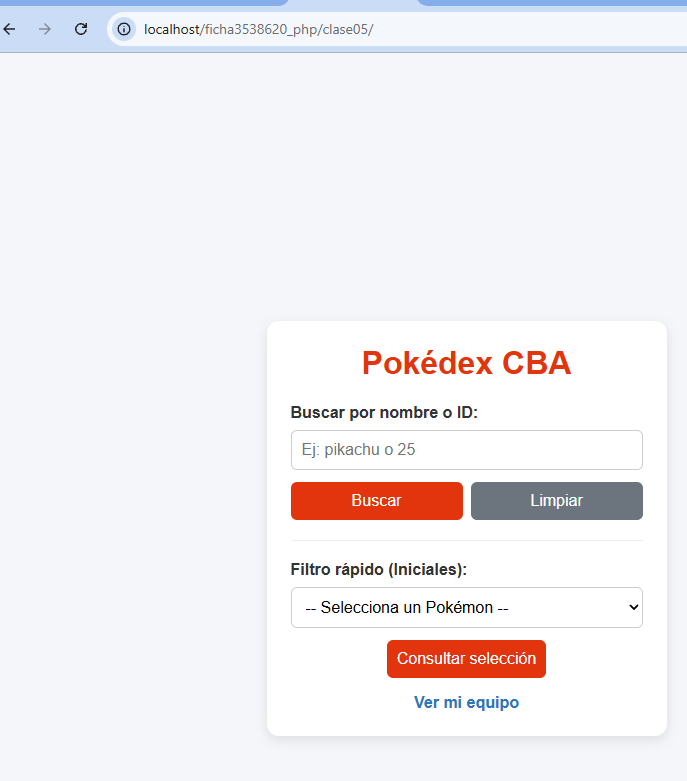

# Proyecto PHP - Pokédex CBA (Consumo de API)

## Descripción y Objetivo
Aplicación web desarrollada en el Técnico en Programación de Software para practicar la integración con la **PokéAPI** (`https://pokeapi.co`), manejo de sesiones y control de versiones con Git y GitHub.

## Captura de pantalla


## API Utilizada
- **PokéAPI** (RESTful Pokémon API, sin autenticación requerida).
- **Endpoint principal:** `GET /pokemon/{nombre_o_id}` para obtener estadísticas, peso, altura e imágenes.

### Ejemplo de respuesta JSON
```json
{
  "id": 25,
  "name": "pikachu",
  "height": 4,
  "weight": 60,
  "base_experience": 112,
  "sprites": {
    "front_default": "https://githubusercontent.com"
  },
  "stats": [{"base_stat": 35, "stat": {"name": "hp"}}]
}
```

## Flujo básico de la aplicación
```text
Usuario → HTML / Formulario (index.php) → Petición HTTP GET (pokemon.php) → PHP / cURL (funciones.php) → PokéAPI → Respuesta JSON → Decodificación en PHP → Interfaz Visual
```

## Arquitectura y Funcionalidades
- **Estructura principal:** `index.php` (buscador), `pokemon.php` (detalle), `funciones.php` (lógica y conexión API) y módulos de gestión de equipo (`equipo.php`, `agregar.php`, `eliminar.php`, `vaciar.php`).
- **Características:** Búsqueda por nombre o ID, gestión temporal de equipo Pokémon y validación de errores.

## Limitaciones y Aprendizajes
- **Limitaciones:** Dependencia de conexión a internet, búsqueda en inglés o por ID numérico, y almacenamiento temporal sin base de datos persistente.
- **Aprendizajes:** Consumo de APIs REST con PHP, manejo seguro de respuestas JSON, prevención de errores críticos y flujo de trabajo profesional con Git (`branches`, Pull Requests y commits).

## Ejecución local
1. Clonar el repositorio y ubicarlo en `C:\xampp\htdocs/`.
2. Iniciar el servicio **Apache** en XAMPP.
3. Acceder en el navegador a `http://localhost/nombre-del-repositorio/`.

## Autor
- **Sofia Jimenez Aguilera** (Ficha: 3538620) - SENA
